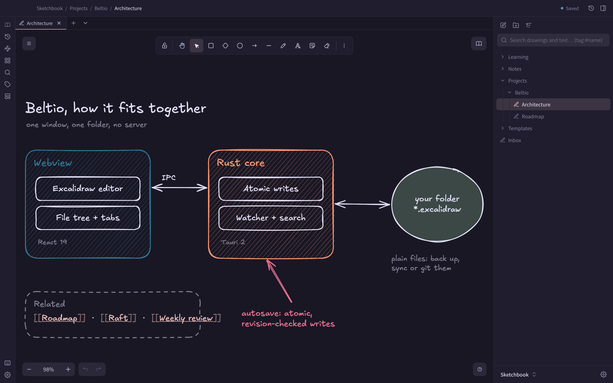

# Vaultdraw

An offline vault for Excalidraw drawings. Pick a folder, and every drawing in it is a plain `.excalidraw` file you own.

No account, no cloud, no telemetry.

[](https://vaultdraw.swarnim-114.workers.dev)

## What it does

- **Your folder is the vault.** Drawings and folders are real files on disk, so you can back them up, sync them or put them in git.
- **Excalidraw editor** with a file tree beside it, tabs, and autosave with crash recovery.
- **Search inside drawings**, including text and labels.
- **Links and graph.** Link drawings with `[[Name]]`, see backlinks, and browse the vault as a graph.
- **File history.** Automatic versions and named checkpoints, with restore.
- **Pages and PDF.** Page mode for A4, Letter and other sizes, and PDF import to annotate.
- **Export** to PNG, SVG and PDF, or copy to the clipboard.
- **Themes.** Nine built in, light and dark, in the Noctalia format.
- **Keyboard first.** A command palette for every action, with customisable keys.

## Install

Download the DMG from the [releases page](https://github.com/Vaultdraw/vaultdraw/releases/latest), or use Homebrew, which also installs the `vaultdraw` command:

```bash
brew install --cask vaultdraw/tap/vaultdraw
```

macOS only. The build is unsigned, so the first open needs one extra step. See the [install guide](https://vaultdraw.swarnim-114.workers.dev/docs/install/).

## Repository

https://github.com/Vaultdraw/vaultdraw
