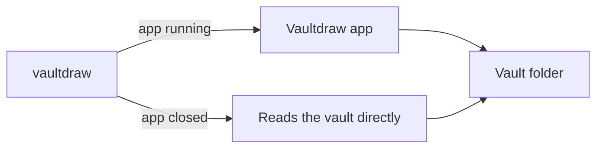

`vaultdraw` lets you use your vault from Terminal and scripts: list, search, read and write drawings, and drive the running app.

## Install

If you installed Vaultdraw with Homebrew, the command is already there. Otherwise open the command palette (**Cmd+Shift+P**) and run one of:

- **Install 'vaultdraw' command in PATH** links it into `~/.local/bin`.
- **Install 'vaultdraw' command in /usr/local/bin** links it there instead, for every user.

Check it works:

```bash
vaultdraw status
```

If it stops with `Killed: 9`, see [troubleshooting](/docs/troubleshooting/#the-vaultdraw-command-says-killed-9).

## With or without the app



*When the app runs, the command asks it. When the app is closed, file commands read and write the vault directly.*

- **App running:** every command goes through the app, so edits show up in the window at once.
- **App closed:** [file commands](/docs/cli-files/) still work on the most recent vault, or the one given with `--vault`. [App commands](/docs/cli-app/) such as `open` and `tabs` need the app.

Both paths give the same output.

## Options for every command

| Option | What it does |
| --- | --- |
| `--json` | Print stable JSON instead of text, for scripts |
| `--vault <PATH>` | Vault to read when the app is closed |
| `--offline` | Never go through the app (refused while the app is running) |
| `--path` | Treat names as exact vault-relative paths |
| `--file` | Treat names as link-style drawing names |
| `--timeout <SECS>` | How long to wait for the app (default 30) |

A target such as `Roadmap` is matched like a `[[link]]`. Anything that contains `/` or ends in `.excalidraw` is a path.

## Exit codes

| Code | Meaning |
| --- | --- |
| 0 | Success |
| 1 | Usage or local error |
| 2 | The app or vault refused, for example a write conflict |
| 3 | The app is not running and the command needs it |
| 4 | Protocol error |

## Help and completions

```bash
vaultdraw --help             # every command
vaultdraw search --help      # one command
vaultdraw completions zsh    # bash, zsh, fish, elvish or nushell
```

For zsh, save the output in a folder on your `fpath`, for example:

```bash
vaultdraw completions zsh > ~/.zfunc/_vaultdraw
```
