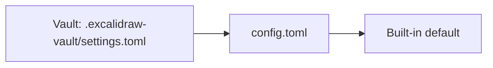

All settings live in one plain-text folder, like kitty, Ghostty or Zed. Edit it by hand or in [Settings](/docs/settings/); both stay in sync.

## Where it lives

| OS | Config folder | Machine state |
| --- | --- | --- |
| macOS, Linux | `$XDG_CONFIG_HOME/vaultdraw`, else `~/.config/vaultdraw` | `$XDG_STATE_HOME/vaultdraw/state.json`, else `~/.local/state/vaultdraw/state.json` |
| Windows | `%APPDATA%\Vaultdraw` | `%LOCALAPPDATA%\Vaultdraw\state.json` |

On macOS the config folder is `~/.config/vaultdraw` unless you set `XDG_CONFIG_HOME`. Run `vaultdraw config path` to print the exact path of `config.toml`.

```text
vaultdraw/
├── config.toml   your settings
├── themes/       colour themes
└── templates/    templates shared by all vaults
```

`config.toml` is created on first launch, with a comment explaining each key. `state.json` holds machine state (recent vaults, navigator width, expanded folders, last-used image export options). It is not meant for hand editing.

## How it behaves

- **Settings and the file stay in sync.** Changing something in Settings updates `config.toml` and keeps your comments and layout. Editing the file updates the app.
- **Live reload.** Saved changes apply immediately, with no restart. Delete a line to go back to its default.
- **Typos are safe.** If the file can't be parsed, the app keeps the last good settings and shows a banner such as `config.toml line 7: <error>`. A value of the wrong type falls back to its default and is reported the same way.
- **Settings → Open config folder** opens the folder; **Reload** re-reads it.

## Precedence



*A value comes from the vault's settings file if set there, otherwise from config.toml, otherwise the built-in default.*

Only some settings can be set per vault. See [Per-vault settings](/docs/per-vault-settings/).

## [appearance]

| Key | Default | Values |
| --- | --- | --- |
| `theme` | `"Default"` | A built-in theme or one in `themes/` (see [Themes](/docs/themes/)) |
| `mode` | `"system"` | `light`, `dark`, `system` |
| `sync_canvas` | `false` | The canvas follows the theme's colours |
| `canvas_background` | `"#ffffff"` | Background of new drawings when `sync_canvas` is off |
| `accent_color` | `""` | `"#rrggbb"` replaces the theme's primary colour; empty is the theme's own |

## [editor]

Defaults for new elements.

| Key | Default | Values |
| --- | --- | --- |
| `font_family` | `5` | 5 Excalifont, 6 Nunito, 8 Comic Shanns, 1 Virgil, 2 Helvetica, 3 Cascadia |
| `font_size` | `20` | Number |
| `stroke_color` | `"#1e1e1e"` | Colour |
| `background_color` | `"transparent"` | Colour or `transparent` |
| `fill_style` | `"solid"` | `solid`, `hachure`, `cross-hatch` |
| `stroke_width` | `2` | Number |
| `roughness` | `1` | 0 architect, 1 artist, 2 cartoonist |

## [paper]

The paper style for new drawings. Each drawing can change its own.

| Key | Default | Values |
| --- | --- | --- |
| `style` | `"plain"` | `plain`, `grid`, `lines`, `dots`, `graph`, `isometric` |
| `spacing` | `0` | 5 to 200; 0 is the style's own |
| `color` | `""` | `"#rrggbb"`; empty is automatic |
| `opacity` | `1` | 0.1 to 1 |
| `major_every` | `0` | Grid and graph: a stronger line every N, 1 to 20; 0 is the style's own |
| `margin_line` | `true` | Ruled lines: draw the margin line |

## [page]

Page mode for new drawings. See [Page mode](/docs/page-mode/).

| Key | Default | Values |
| --- | --- | --- |
| `mode` | `"normal"` | `normal` (infinite canvas), `page` |
| `layout` | `"separate"` | `separate` (sheets with a gap), `continuous` (one long page) |
| `size` | `"a4"` | `a3`, `a4`, `a5`, `b5`, `letter`, `legal`, `tablet`, `tabletLarge`, `phone`, `custom` |
| `orientation` | `"portrait"` | `portrait`, `landscape` |
| `width`, `height` | `0` | Custom size in pixels, 100 to 5000; 0 is unset |
| `paper_theme` | `"normal"` | `normal`, `old_school`, `match` |

## [saving], [interface], [navigator], [files]

| Key | Default | Values |
| --- | --- | --- |
| `saving.autosave_delay_ms` | `500` | Idle time before an edit is written to disk |
| `interface.zoom` | `100` | Whole-app zoom, 50 to 200 percent |
| `interface.show_tag_chips` | `true` | Show a drawing's tags as chips in the file tree |
| `interface.thumbnails` | `true` | Drawing previews on the home screen, in search results and in the palette |
| `interface.activity_bar` | `true` | Show the activity bar |
| `navigator.sort` | `"name_asc"` | `name_asc`, `name_desc`, `modified_desc`, `modified_asc` |
| `files.confirm_delete` | `true` | Ask before moving to Trash |
| `files.new_drawing_folder` | `""` | Relative to the vault root; empty is next to the open drawing |
| `files.templates_folder` | `"Templates"` | Vault folder holding templates, relative to the vault root |

## [tabs]

See [Tabs](/docs/tabs/).

| Key | Default | Values |
| --- | --- | --- |
| `enabled` | `true` | `false` opens one drawing at a time |
| `show_strip` | `"always"` | `always`, `never` (switch with the keyboard only) |
| `open_from_navigator` | `"current"` | `current` (replace the open drawing), `new` |
| `focus_new` | `true` | Switch to a drawing opened in a new tab |
| `new_tab_position` | `"after_active"` | `after_active`, `end` |
| `ctrl_tab` | `"mru"` | `mru` (last used), `order` (strip order) |
| `close_pinned` | `false` | Allow Cmd+W to close pinned tabs |
| `restore` | `true` | Reopen the open tabs when a vault opens |
| `undo_budget_mb` | `32` | Undo history kept for background tabs, 0 to 1024; 0 is none |

## [history]

See [History](/docs/history/). All of these can be set per vault.

| Key | Default | Meaning |
| --- | --- | --- |
| `enabled` | `true` | Make versions of your drawings |
| `interval_minutes` | `5` | How often a version is saved while you draw; 0 is no timed versions |
| `keep_all_hours` | `1` | Keep every version for this long |
| `keep_hourly_hours` | `24` | Then one per hour for this long |
| `keep_daily_days` | `30` | Then one per day for this long |
| `keep_weekly_weeks` | `0` | Then one per week; 0 keeps weekly versions forever |
| `size_cap_mb` | `500` | Size limit |
| `highlight_changes` | `true` | Highlight changes in the preview |

## [links] and [pdf_import]

```toml
[links]                            # see Links
new_link_format = "shortest"       # shortest | relative | absolute
shape_link_format = "wikilink"     # wikilink | vaultdraw-url
open_modifier = "mod"              # mod | alt | ctrl | shift
update_on_rename = true            # true | false | "ask"
autocomplete = true                # the list that opens on [[
hint_chars = "asdfghjkl"           # letters used by Shift+F hints
style_links = true                 # draw [[links]] in the link colour, underlined
color = "accent"                   # accent (theme) | "#rrggbb"
hover_preview = "always"           # always | modifier | off

[pdf_import]                       # see PDF import
max_side = 1440                    # longest side in pixels, 600 to 3000
format = "jpeg"                    # jpeg | png
quality = 0.85                     # JPEG quality, 0.5 to 1
lock_pages = true                  # lock imported pages
warn_pages = 50                    # warn above this many pages
pixel_budget_mp = 60               # decoded-pixel budget in megapixels, 10 to 400
```

## [tools], [pens] and [laser]

One table per tool sets its default style. See [Tool defaults](/docs/tool-defaults/) for every key.

```toml
[tools.arrow]
stroke_color = "#f08c00"
stroke_width = 3
stroke_style = "dotted"

[laser]
color = "red"
size = 2          # trail thickness in pixels, 1 to 24
decay_ms = 1000   # time until the trail fades, 200 to 5000
length = 50       # tail length in points, 5 to 200
```

## [hotkeys]

Only your changes are stored, as a list of keys per command id. See [Keyboard and command palette](/docs/keyboard/#changing-keys).

```toml
[hotkeys]
"file.save" = ["Mod+S", "Alt+S"]
"vault.newDrawing" = []
```
