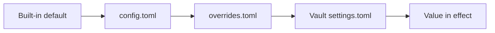

All settings live in one plain-text folder, like kitty, Ghostty or Zed. Edit it by hand or in [Settings](/docs/settings/); both stay in sync.

## Where it lives

| OS | Config folder | Machine state |
| --- | --- | --- |
| macOS, Linux | `$XDG_CONFIG_HOME/vaultdraw`, else `~/.config/vaultdraw` | `$XDG_STATE_HOME/vaultdraw/state.json`, else `~/.local/state/vaultdraw/state.json` |
| Windows | `%APPDATA%\Vaultdraw` | `%LOCALAPPDATA%\Vaultdraw\state.json` |

On macOS the config folder is `~/.config/vaultdraw` unless you set `XDG_CONFIG_HOME`. Run `vaultdraw config path` to print the exact path of `config.toml`.

```text
vaultdraw/
├── config.toml   your settings
├── themes/       colour themes
├── snippets/     CSS snippets
└── templates/    templates shared by all vaults
```

`config.toml` is created on first launch, with a comment explaining each key. `state.json` holds machine state (recent vaults, navigator width, expanded folders, last-used image export options). It is not meant for hand editing.

## How it behaves

- **Settings and the file stay in sync.** Editing the file updates the app, and changing something in Settings updates the app at once. Where Settings saves the change depends on the version: see [Layers](#layers).
- **Live reload.** Saved changes apply immediately, with no restart. Delete a line to go back to its default.
- **Typos are safe.** If the file can't be parsed, the app keeps the last good settings and shows a banner such as `config.toml line 7: <error>`. A value of the wrong type falls back to its default and is reported the same way.
- **Settings → Open config folder** opens the folder; **Reload** re-reads it.

> **Next release.** Settings no longer rewrites `config.toml`, and a key the app doesn't know is reported. Both are described below and are not in the current download yet. In 0.1.2, Settings writes to `config.toml` and keeps your comments and layout.

## Layers

A setting's value comes from the first of these that sets it, highest first:

| Layer | File | Written by |
| --- | --- | --- |
| Vault | `<vault>/.excalidraw-vault/settings.toml` | Settings, with **This vault** on |
| Overrides | `overrides.toml` in the state folder, next to `state.json` | Settings, `vaultdraw config set`, the control API |
| Your file | `config.toml` in the config folder | you, by hand |
| Built-in | the app | nobody |



*Each layer wins over the ones to its left. Settings, the command line and the control API write `overrides.toml`, never `config.toml`.*

- **Next release: your `config.toml` stays as you wrote it.** Comments, order and layout are kept, and a dotfiles checkout or a read-only config folder works.
- A Settings change that matches `config.toml` is not stored. **Reset** over a value that `config.toml` sets stores the default, so the default wins.
- `overrides.toml` is plain TOML and safe to delete: values fall back to `config.toml` at once. It reloads live.
- Nothing is migrated. What older versions wrote into `config.toml` stays there as the base layer.
- If either file is broken, the app keeps the last good settings, the banner names the file, and Settings refuses to save until you fix the file or delete `overrides.toml`.
- Older versions ignore `overrides.toml`.

Only some settings can be set per vault. See [Per-vault settings](/docs/per-vault-settings/).

### Including other files

> **Next release.** Not in the current download yet.

`[include]` in `config.toml` pulls in other TOML files or folders of them, to split a config or share part of it between machines:

```toml
[include]
files = ["keys.toml", "machine/", "~/dotfiles/vaultdraw/colors.toml"]
```

Relative paths are against the including file, and `~` works. Includes nest up to 8 deep, each file loads once, and `config.toml` wins over what it includes. Nothing is loaded that you did not name. A missing or broken included file is a warning, and the rest applies. Files inside a vault and symlinks are refused. Vaultdraw never writes to an included file, and editing one reloads live. Without an `[include]` it costs nothing.

## Where a value comes from

> **Next release.** Not in the current download yet.

A setting that is not at its built-in default shows a small chip beside its name: `config.toml` or `overrides`. When Settings hides a different `config.toml` value, the note names it ("config.toml says 14"), and **Reset to config.toml value** removes the stored value without touching your file.

**Settings → General → Config files** lists both files with their paths and status, an **Open** button for each, **Reload**, and **Reset all Settings changes**.

| Command | Does |
| --- | --- |
| `config.reload` | Re-read the config files now |
| `config.openFile` | Open `config.toml` |
| `config.openOverrides` | Show `overrides.toml` in the file manager |
| `config.openFolder` | Open the config folder |
| `config.resetOverrides` | Delete `overrides.toml` after a confirmation |

They have no default keys; bind them in [Hotkeys](/docs/keyboard/). From Terminal:

```bash
vaultdraw config get editor.font_size --source
# 20  (overrides.toml; config.toml says 14)
vaultdraw config path --all      # config.toml, then overrides.toml
```

## Check your config

> **Next release.** Not in the current download yet.

`vaultdraw config check` reads `config.toml` and `overrides.toml` and prints each problem with its file, line and column. A key it doesn't know gets a "did you mean" hint. It works with the app closed, only reads, and never uses the network.

```bash
vaultdraw config check
# config.toml:2:1: warning: unknown key interface.zom (ignored; did you mean interface.zoom?)
# config.toml:3:1: error: interface.zoom = "big" is not valid (expected a whole number between 50 and 200)
# 1 error, 1 warning in 1 config file.
```

| Exit code | When |
| --- | --- |
| 0 | No errors (warnings are allowed) |
| 1 | At least one error; with `--strict`, any warning too |

`--json` prints the report as JSON. In the app, run **Config: Check config files** from the palette, or press **Check** in **Settings → General → Config files**.

**Editor completion.** `vaultdraw config schema` prints a JSON Schema of `config.toml`. Save it and add `#:schema ./config.schema.json` as the first line of `config.toml`; editors that read it (taplo, Even Better TOML) then complete and check keys. Nothing is fetched from the network.

```bash
vaultdraw config schema > ~/.config/vaultdraw/config.schema.json
```

**Debug info.** `vaultdraw doctor`, or **Config: Show debug info** in the palette, prints one read-only report for bug reports: versions, folders, config files, the keys you changed and the file each comes from, extensions, the vault's search index and the control socket. It writes nothing and works with the app closed. It contains your folder paths, so read it before you paste it into an issue.

## [appearance]

| Key | Default | Values |
| --- | --- | --- |
| `theme` | `"Default"` | A built-in theme or one in `themes/` (see [Themes](/docs/themes/)) |
| `mode` | `"system"` | `light`, `dark`, `system` |
| `sync_canvas` | `false` | The canvas follows the theme's colours |
| `canvas_background` | `"#ffffff"` | Background of new drawings when `sync_canvas` is off |
| `accent_color` | `""` | `"#rrggbb"` replaces the theme's primary colour; empty is the theme's own |
| `snippets` | `[]` | CSS snippets to apply, by file name without `.css`, in order (see [Themes](/docs/themes/#css-snippets)). Next release |

## [editor]

Defaults for new elements.

| Key | Default | Values |
| --- | --- | --- |
| `font_family` | `5` | 5 Excalifont, 6 Nunito, 8 Comic Shanns, 1 Virgil, 2 Helvetica, 3 Cascadia |
| `font_size` | `20` | Number |
| `stroke_color` | `"#1e1e1e"` | Colour |
| `background_color` | `"transparent"` | Colour or `transparent` |
| `fill_style` | `"solid"` | `solid`, `hachure`, `cross-hatch` |
| `stroke_width` | `2` | Number |
| `roughness` | `1` | 0 architect, 1 artist, 2 cartoonist |

## [paper]

The paper style for new drawings. Each drawing can change its own.

| Key | Default | Values |
| --- | --- | --- |
| `style` | `"plain"` | `plain`, `grid`, `lines`, `dots`, `graph`, `isometric` |
| `spacing` | `0` | 5 to 200; 0 is the style's own |
| `color` | `""` | `"#rrggbb"`; empty is automatic |
| `opacity` | `1` | 0.1 to 1 |
| `major_every` | `0` | Grid and graph: a stronger line every N, 1 to 20; 0 is the style's own |
| `margin_line` | `true` | Ruled lines: draw the margin line |

## [page]

Page mode for new drawings. See [Page mode](/docs/page-mode/).

| Key | Default | Values |
| --- | --- | --- |
| `mode` | `"normal"` | `normal` (infinite canvas), `page` |
| `layout` | `"separate"` | `separate` (sheets with a gap), `continuous` (one long page) |
| `size` | `"a4"` | `a3`, `a4`, `a5`, `b5`, `letter`, `legal`, `tablet`, `tabletLarge`, `phone`, `custom` |
| `orientation` | `"portrait"` | `portrait`, `landscape` |
| `width`, `height` | `0` | Custom size in pixels, 100 to 5000; 0 is unset |
| `paper_theme` | `"normal"` | `normal`, `old_school`, `match` |

## [saving], [interface], [navigator], [files]

| Key | Default | Values |
| --- | --- | --- |
| `saving.autosave_delay_ms` | `500` | Idle time before an edit is written to disk |
| `interface.zoom` | `100` | Whole-app zoom, 50 to 200 percent |
| `interface.show_tag_chips` | `true` | Show a drawing's tags as chips in the file tree |
| `interface.thumbnails` | `true` | Drawing previews on the home screen, in search results and in the palette |
| `interface.thumbnail_max_elements` | `8000` | Biggest drawing that gets a thumbnail, 100 to 50000. Next release (before it was fixed at 2,500). Bigger drawings keep a placeholder. Applies live. Lower it on a slow machine |
| `interface.activity_bar` | `true` | Show the activity bar |
| `navigator.sort` | `"name_asc"` | `name_asc`, `name_desc`, `modified_desc`, `modified_asc` |
| `files.confirm_delete` | `true` | Ask before moving to Trash |
| `files.new_drawing_folder` | `""` | Relative to the vault root; empty is next to the open drawing |
| `files.templates_folder` | `"Templates"` | Vault folder holding templates, relative to the vault root |

## [memory]

> **Next release.** Not in the current download yet. Both keys are merged in the app and come with the next version.

| Key | Default | Values |
| --- | --- | --- |
| `memory.free_unused_images` | `true` | Free the image data of deleted images once no undo or redo step can restore it, about 20 seconds after you stop editing |
| `memory.undo_steps` | `1000` | Undo steps kept per drawing, 10 to 10000 (undo was unlimited before) |

Both are in **Settings → Interface → Memory** and apply live. See [Settings](/docs/settings/#memory).

## [tabs]

See [Tabs](/docs/tabs/).

| Key | Default | Values |
| --- | --- | --- |
| `enabled` | `true` | `false` opens one drawing at a time |
| `show_strip` | `"always"` | `always`, `never` (switch with the keyboard only) |
| `open_from_navigator` | `"current"` | `current` (replace the open drawing), `new` |
| `focus_new` | `true` | Switch to a drawing opened in a new tab |
| `new_tab_position` | `"after_active"` | `after_active`, `end` |
| `ctrl_tab` | `"mru"` | `mru` (last used), `order` (strip order) |
| `close_pinned` | `false` | Allow Cmd+W to close pinned tabs |
| `restore` | `true` | Reopen the open tabs when a vault opens |
| `undo_budget_mb` | `32` | Undo history kept for background tabs, 0 to 1024; 0 is none |

## [history]

See [History](/docs/history/). All of these can be set per vault.

| Key | Default | Meaning |
| --- | --- | --- |
| `enabled` | `true` | Make versions of your drawings |
| `interval_minutes` | `5` | How often a version is saved while you draw; 0 is no timed versions |
| `keep_all_hours` | `1` | Keep every version for this long |
| `keep_hourly_hours` | `24` | Then one per hour for this long |
| `keep_daily_days` | `30` | Then one per day for this long |
| `keep_weekly_weeks` | `0` | Then one per week; 0 keeps weekly versions forever |
| `size_cap_mb` | `500` | Size limit |
| `highlight_changes` | `true` | Highlight changes in the preview |

## [links] and [pdf_import]

```toml
[links]                            # see Links
new_link_format = "shortest"       # shortest | relative | absolute
shape_link_format = "wikilink"     # wikilink | vaultdraw-url
open_modifier = "mod"              # mod | alt | ctrl | shift
update_on_rename = true            # true | false | "ask"
autocomplete = true                # the list that opens on [[
hint_chars = "asdfghjkl"           # letters used by Shift+F hints
style_links = true                 # draw [[links]] in the link colour, underlined
color = "accent"                   # accent (theme) | "#rrggbb"
hover_preview = "always"           # always | modifier | off

[pdf_import]                       # see PDF import
max_side = 1440                    # longest side in pixels, 600 to 3000
format = "jpeg"                    # jpeg | png
quality = 0.85                     # JPEG quality, 0.5 to 1
lock_pages = true                  # lock imported pages
warn_pages = 50                    # warn above this many pages
pixel_budget_mp = 60               # decoded-pixel budget in megapixels, 10 to 400
```

## [tools], [pens] and [laser]

One table per tool sets its default style. See [Tool defaults](/docs/tool-defaults/) for every key.

```toml
[tools.arrow]
stroke_color = "#f08c00"
stroke_width = 3
stroke_style = "dotted"

[laser]
color = "red"
size = 2          # trail thickness in pixels, 1 to 24
decay_ms = 1000   # time until the trail fades, 200 to 5000
length = 50       # tail length in points, 5 to 200
```

## [hotkeys]

Only your changes are stored, as a list of keys per command id. See [Keyboard and command palette](/docs/keyboard/#changing-keys).

```toml
[hotkeys]
"file.save" = ["Mod+S", "Alt+S"]
"vault.newDrawing" = []
```

## [keys]

> **Next release.** Not in the current download yet. Key sequences are merged in the app and come with the next version.

Options for key sequences such as `"g g"` or `"<leader> f f"` in `[hotkeys]`. Nothing is bound by default. All keys reload live.

```toml
[keys]
leader = "Backslash"            # what <leader> means in a sequence
timeout_ms = 1000
cancel_after_ms = 5000
which_key = true
which_key_delay_ms = 400
which_key_position = "bottom"   # bottom | center

[keys.labels]                   # names for groups, shown in the which-key popup
"<leader> f" = "file"
```

| Key | Default | Values |
| --- | --- | --- |
| `keys.leader` | `"Backslash"` | One key that `<leader>` stands for, such as `"Space"` or `"Alt+K"` |
| `keys.timeout_ms` | `1000` | Wait before the shorter binding runs when a key is also the start of a longer one (`g` and `g g`); 0 waits for the next key |
| `keys.cancel_after_ms` | `5000` | Drop a half-typed sequence after this idle time; 0 never drops it |
| `keys.which_key` | `true` | Show the popup while a sequence is half typed |
| `keys.which_key_delay_ms` | `400` | Wait before the popup shows |
| `keys.which_key_position` | `"bottom"` | `"bottom"` (a bar) or `"center"` (a card) |
| `keys.labels` | none | A table: sequence to group name. Edit it in **Settings → Hotkeys → Key group names** |

The times are in milliseconds, 0 to 3600000. See [Keyboard](/docs/keyboard/#key-sequences-leader-and-which-key).

## [control] and [ai]

> **Next release.** Not in the current download yet. `control.enabled` is in 0.1.2; the other keys are merged in the app and come with the next version.

| Key | Default | Values |
| --- | --- | --- |
| `control.enabled` | `true` | The local control socket that the `vaultdraw` command uses. Applies at the next launch |
| `control.uri_enabled` | `true` | `false` ignores every `vaultdraw://` link and every file opened from outside, and shows a notice instead |
| `control.uri_allow` | `[]` | What a link may do without asking: `"new"`, `"switch-vault"`, or a command id such as `"appearance.toggleMode"` |
| `control.notify_edits` | `true` | Shows a notice when a script or AI tool edits the drawing on screen. `false` hides it; the edit still happens |
| `ai.enabled` | `false` | The AI switch. Off means no AI app can read or edit your drawings |
| `ai.mcp_enabled` | `true` | The AI tools interface. It opens only while both `ai` keys are `true` |

The link keys are read each time a link arrives, and `control.notify_edits` at each edit, so edits apply at once. See [Links and files from outside](/docs/links-from-outside/).

### AI

AI is off by default, and while it is off Vaultdraw is fully offline. Turning it on lets an AI app you connect (a desktop assistant or a coding agent) read and edit your drawings through the running app. Vaultdraw sends nothing itself: what the AI app reads, it sends to its own provider under its own terms.

```toml
[ai]
enabled = false       # the AI switch
mcp_enabled = true    # the AI tools interface, used only while enabled is true
```

- **Where.** **Settings → Control** has the switch, the tools interface under it, and **Edit notices**. The palette commands **AI: Toggle AI** and **AI: Toggle AI tools interface (MCP)** have no default keys.
- **A warning first.** Turning AI on in Settings or with the command shows what an AI app can read and where it sends it. Setting the key by hand shows no warning.
- **Live.** The app checks both keys at every AI request, so turning AI off applies at once, with no restart.
- **Fails closed.** If `config.toml` or `overrides.toml` can't be read, AI counts as off.
- **Honest limit.** The switch stops AI apps that use the AI tools interface. An AI app that can run shell commands as you can still call the `vaultdraw` command like any program you run. Only give such an app access you would give a script.
- **Not yet.** The `vaultdraw mcp` command that AI apps connect through comes in a later version; the switch is already in place for it.

