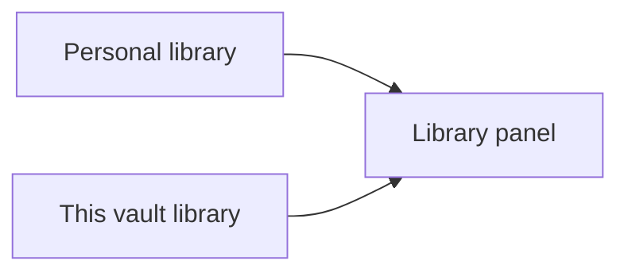

## Pens

A pen preset is a saved freehand pen. Vaultdraw ships five, and you can have up to nine.

| Pen | Colour | Width | Notes |
| --- | --- | --- | --- |
| Fine liner | dark | 0.5 | constant width |
| Marker | dark | 2 | constant width |
| Brush | dark | 1.5 | varies with pressure and speed |
| Red pen | red | 1 | constant width |
| Highlighter | yellow | 10 | 40% opacity, drawn behind other elements |

Each preset stores a name, colour, width in pixels, opacity, pressure (on for variable width), smoothing and whether it is a highlighter.

To use one, press the pen tool and pick a preset from the pen bar, or press **Option+1** to **Option+9** from any tool. That switches to the pen tool with that preset. The keys work everywhere except text fields, and you can rebind them on the Hotkeys page. You can also run `Pen: <name>` from the command palette. The chosen preset isn't remembered across restarts.

> **Tip:** The pen bar has a **Pens settings** link that opens the editor for your presets.

### Highlighter

A highlighter stroke is a normal translucent freehand stroke. Vaultdraw places it just above the topmost image, embed, sticky note or filled shape, so it sits behind your text and ink but is never lost behind a background. It opens as an ordinary stroke on excalidraw.com.

### Edit your pens

Open **Settings → Tools** and choose the **Pen** tab. You can pick a saved pen, edit it, add or remove pens, and reset to the built-in five. The command `Settings: Pens & laser` opens the same tab.

In `config.toml`, presets are a list of inline tables, one per line:

```toml
[pens]
presets = [
  { name = "Marker", color = "#1e1e1e", width = 2, opacity = 100, pressure = false, smoothing = 0.5, highlighter = false },
  { name = "Highlighter", color = "#ffd43b", width = 10, opacity = 40, pressure = false, smoothing = 0.5, highlighter = true },
]
```

If the list has a mistake, Vaultdraw falls back to the built-in pens and shows a banner.

## Laser pointer

The laser leaves a trail that fades away and writes nothing into the drawing. Set its look in the **Laser** tab of **Settings → Tools**, or in `config.toml`:

```toml
[laser]
color = "red"
size = 2        # 1 to 24 px
decay_ms = 1000 # 200 to 5000, how long the trail lasts
length = 50     # 5 to 200 points in the tail
```

The values shown are the defaults. Other tools keep their own defaults: see [Tool defaults](/docs/tool-defaults/).

## Libraries

A library holds shapes you reuse. Open it from the header, the canvas menu or the command palette (**Library: Open/close**). Libraries are kept between sessions as standard `.excalidrawlib` files, so excalidraw.com can read them.



*The library panel shows two libraries together: Personal, shared by every vault, and This vault.*

| Library | File |
| --- | --- |
| **Personal** | `library.excalidrawlib` in the config folder, shared by all vaults |
| **This vault** | `library.excalidrawlib` at the vault root, created when you add the first item. It travels with the vault. |

### Work with items

- Select shapes and use the add tile in either section, or right-click and choose **Add to library**, which goes to Personal.
- Every item needs a name. Type it in the field that appears, then press Enter. Esc cancels. Imported items show as "Untitled" until you rename them.
- Rename by double-clicking the name, or from the **⋯** menu or the right-click menu.
- Hover a tile for a larger preview. Previews use the colours you see on the canvas.
- Search matches item names, text, labels and frame names.
- With items selected you can move or copy them to the other library, export them, or remove them. With nothing selected you can import into or export or clear either library.
- Drop an `.excalidrawlib` file on the canvas to add it to Personal.
- Run `Insert: <library item>` from the command palette to place an item without opening the panel.

If you edit a library file outside the app, for example with a sync tool, the change shows up live and nothing you added is lost. A file Vaultdraw can't read is never overwritten: that library becomes read-only until you fix it.

Vaultdraw is offline, so there is no **Browse libraries** or **Publish** button.
