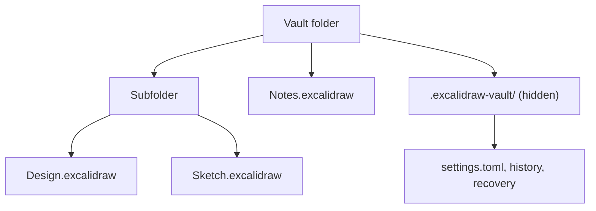

A vault is just a folder. Vaultdraw shows what is in it and saves your drawings there as ordinary `.excalidraw` files.

## Steps

1. **Open Vaultdraw.** On first launch it asks for a folder.
2. **Pick a folder.** Any folder works: an empty one, one that already holds `.excalidraw` files, or one inside iCloud Drive, Dropbox or a git repository. Vaultdraw reopens it next time. Nothing is copied or converted.
3. **Make a drawing.** Press **Cmd+N**, or press **Cmd+Option+N** to start from a [template](/docs/templates/).
4. **Draw.** There is no save button to remember. Your edits are written to disk shortly after you stop (see [Vault and files](/docs/vault/)).
5. **Find a drawing.** Press **Cmd+P** and type a few letters of its name. Letters only have to appear in order, so `rft` finds `Raft`.
6. **Run any command.** Press **Cmd+Shift+P**. Every feature is in there, from themes to export.

## What the vault looks like

*A vault folder holds subfolders and .excalidraw drawings, plus a hidden .excalidraw-vault folder with the vault's own settings, history and recovery data.*

The hidden `.excalidraw-vault/` folder is where Vaultdraw keeps what belongs to this vault: its settings (`settings.toml`), file history and crash recovery. Your drawings never depend on it, and the folder travels with the vault when you copy or sync it.

## Where next

- [A quick tour](/docs/tour/) of the window.
- [Vault and files](/docs/vault/) for what Vaultdraw does to keep your files safe.
- [Settings](/docs/settings/) to change how it looks and behaves.
