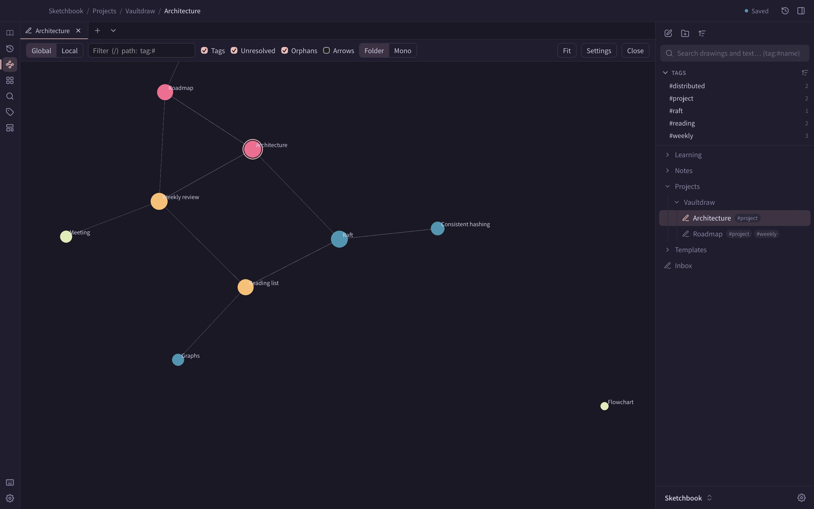

**Cmd+Option+G** shows every drawing as a dot and every link as a line, over the canvas. **Esc**, or the same key again, returns to your drawing at the same zoom and position.

**Cmd+Option+L** opens the **local graph**: the open drawing and the drawings within one to three links of it.

You can also use the **Graph view** button in the file tree toolbar, **Graph view** in the canvas menu, or **Open local graph** in a drawing's **⋯** menu.

## Reading the graph

- Bigger dots have more links.
- Drawings in the same top-level folder share a colour.
- Tags are dots too. Links to drawings that don't exist yet are hollow dots.
- Hover a dot to light up its neighbours. A card shows its name, folder, link counts and shortcut.

Drag a dot and its neighbours follow. Scroll or pinch to zoom, and drag the background to pan.

## Keys

| Key | Action |
| --- | --- |
| h j k l, or arrow keys | Move to the nearest dot in that direction |
| Enter, or click | Open the drawing and close the graph |
| F | Show a letter on every visible dot; type it to open |
| / | Filter by name. `path:Folder` and `tag:#x` work too |
| Shift+L | Switch between global and local |
| 1 2 3 | Local graph depth |
| 0, + and - | Fit, zoom in, zoom out |
| Esc | Close |

**Graph: Toggle orphans**, **Toggle tags**, **Toggle unresolved links** and **Fit graph to view** are in the command palette, with no default key.

## Settings

The settings button in the graph toolbar has colour groups, display options (arrows, label fade, dot size, line thickness) and forces (centre, repel, link strength, link distance). They are saved per vault under `[graph]` in `.excalidraw-vault/settings.toml`. See [Per-vault settings](/docs/per-vault-settings/#the-graph-table).

The layout is saved too, so the graph reopens in the same shape. It is stored in Vaultdraw's state folder, not in your vault, and the graph uses no CPU once it settles.
