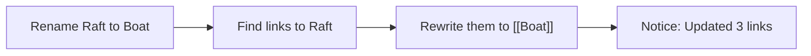

Link drawings to each other, as in a wiki. A link is plain text in the drawing, so it stays readable in any editor and keeps working when you copy the file elsewhere.

## Write a link

Type `[[Name]]` in any text: free text, shape labels or arrow labels. Use `[[Name|label]]` to show a different label. Matching ignores case and accents. When two drawings share a name, add the path: `[[Graphs/BFS]]`.

Typing `[[` opens a list of drawings that narrows as you type.

| Key | Action |
| --- | --- |
| Up / Down, or Ctrl+N / Ctrl+P | Choose a drawing |
| Enter or Tab | Insert the link |
| `\|` | Start a label |
| Esc | Close the list |

The last row, **Create 'x'**, makes a new drawing in the default folder for new drawings. Cmd+clicking a link to a drawing that doesn't exist offers the same.

## How links look

A link is drawn in the link colour and underlined, in the drawing's own font. The brackets stay, dimmed, so the text keeps the same size and wrapping it has on excalidraw.com. A link to a drawing that doesn't exist yet is fainter, with a dashed underline.

Hover a link for a moment to see a preview of the drawing it points to. Exports (PNG, SVG, clipboard, PDF) show the plain `[[Name]]` text.

## Open a link

- **Cmd+click** a link or a linked shape. Holding Cmd underlines every link.
- **Cmd+Option+Enter** opens the link of the selected element.
- **Shift+F** shows a letter on every visible link. Type the letters to open one, as in Vimium.
- **Cmd+Option+Left / Right** go back and forward.

## Link a shape

Select a shape and press **Cmd+Option+K** to pick a drawing. The shape stores `[[Name]]` in its link field, and Cmd+clicking the shape opens the drawing. Relative paths such as `./x.excalidraw` work too, so shape links from the Obsidian Excalidraw plugin open.

## Backlinks panel

**Cmd+Option+B** shows the backlinks panel under the file tree.

- **Backlinks** lists the drawings that link here, with a snippet of each link.
- **Outgoing** lists the links in this drawing. Links to missing drawings have a **Create** button.
- **Unlinked mentions** (collapsed) finds text that matches this drawing's name but isn't linked yet.

Move with **j / k**, open with **Enter**, and switch tabs with **Tab**.

## Rename without breaking links

Renaming or moving a drawing or folder inside Vaultdraw updates every link that points to it, and a notice says what changed, such as "Updated 3 links in 2 drawings". A file that changed on disk during the update is skipped, never overwritten.



*A rename finds every link to the old name and rewrites it.*

Set `links.update_on_rename` to `false` to leave links alone, or to `"ask"` to confirm first.

## Drawing shortcuts

Give a drawing its own key: run **Links: Assign hotkey to this drawing**, or use **Settings → Hotkeys → Drawing shortcuts**. It is stored in `[hotkeys]`:

```toml
[hotkeys]
"drawing.open:Folder/Name.excalidraw" = ["Mod+Alt+1"]
```

## Settings

In **Settings → Links**, or the `[links]` table of [config.toml](/docs/configuration/). The values shown are the defaults.

```toml
[links]
new_link_format = "shortest"   # shortest | relative | absolute
shape_link_format = "wikilink" # wikilink | vaultdraw-url
open_modifier = "mod"          # mod | alt | ctrl | shift
update_on_rename = true        # true | false | "ask"
autocomplete = true            # the list that opens on [[
hint_chars = "asdfghjkl"       # letters used by Shift+F hints
style_links = true             # draw links in the link colour, underlined
color = "accent"               # accent | "#rrggbb"
hover_preview = "always"       # always | modifier | off
```

On excalidraw.com, `[[links]]` show as plain text. Nothing is lost when a file is saved there.
