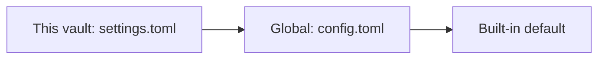

Most settings are global. A few can be different in each vault, so a sketch vault and a notes vault can behave differently.

## Which settings

| Setting | Key |
| --- | --- |
| Navigator sort order | `navigator.sort` |
| Default folder for new drawings | `files.new_drawing_folder` |
| Templates folder | `files.templates_folder` |
| Paper style for new drawings | `paper.*` (style, spacing, colour, opacity, major lines, margin line) |
| Activity bar and its entries | `interface.activity_bar`, `interface.activity_bar_order` |
| Open from the file tree in current or new tab | `tabs.open_from_navigator` |
| Restore open tabs when the vault opens | `tabs.restore` |
| History (on or off, interval, retention, size limit, highlight changes) | `history.*` |
| Each tool's default style | `tools.<tool>` |

The graph view keeps its own per-vault settings in a `[graph]` table (see below).

## Set one in the app

1. Open **Settings** (**Cmd+,**).
2. Switch **Global | This vault** at the top to **This vault**. Only settings that can be per vault are listed.
3. Change a row. It shows "Overridden" and the value is saved in the vault.
4. To go back, click **Reset to global**.

Palette commands: `Settings: Edit this vault's settings` and `Settings: Edit global settings`.

## The file

Overrides live in `<vault>/.excalidraw-vault/settings.toml`:

```toml
# <vault>/.excalidraw-vault/settings.toml
[navigator]
sort = "modified_desc"

[files]
new_drawing_folder = "Sketches/Inbox"
```

Like `config.toml`, it is plain TOML, reloads live and keeps your comments. A bad value is ignored with a notice while the rest still applies.

## Precedence



*A setting is taken from the vault's settings.toml if it is set there, otherwise from config.toml, otherwise the built-in default.*

For tool defaults, a vault's `[tools.arrow]` table replaces the global one as a whole, and an empty vault table means "no defaults for this tool here".

## Travels with the vault

The file is inside the vault folder, so it moves with it when you copy, sync or back up the folder. Settings that belong to your machine, such as the theme, stay in your config folder.

## The `[graph]` table

The settings button in the graph view opens colour groups, display (arrows, label fade, dot size, line thickness) and forces (centre, repel, link strength, link distance). They are stored in the same file under `[graph]`, and only values that differ from the default are written:

```toml
[graph]
show_orphans = false
colour_by = "mono"
local_depth = 3
```

See [Graph view](/docs/graph/).
