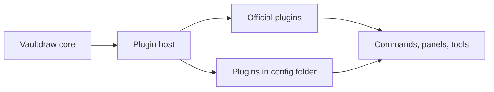

> **Next release (0.2.0).** The official plugins, the plugin settings page and API 0.29.0 are not in the current download ({{version}}) yet. In {{version}} these features are built in, and the plugin host loads only plugins you enable by id. Plugins are experimental: the interface may change.

Optional features are plugins. The core stays small, each plugin loads only when you use it, and one you switch off costs nothing: no command, no service, no memory.

## Official plugins

They are bundled with the app and on by default, except auto-export.

| Plugin | What it adds |
| --- | --- |
| `graph` | The [graph view](/docs/graph/) of links between drawings |
| `gallery` | The thumbnail gallery of drawings |
| `favourites` | Bookmarks for drawings, notes and single elements, in a side panel |
| `formula` | LaTeX formulas, and the TeX renderer for `$…$` in notes (see [Mermaid and LaTeX](/docs/mermaid-and-latex/)) |
| `mermaid` | Mermaid diagrams to Excalidraw shapes |
| `pdf-import` | [PDF import](/docs/pdf-import/) |
| `table` | Pasted spreadsheet cells, CSV or Markdown tables become a table of shapes |
| `markdown-import` | Markdown notes and Obsidian vaults to drawings (see [Notes and Obsidian](/docs/notes-and-obsidian/)) |
| `auto-export` | An SVG or PNG copy of a drawing after each save. Off until you set `[plugin.auto-export] enabled = true` |

Official plugins stay on after an upgrade. To switch one off, use **Settings → Extensions** or **Settings → Plugins**, the palette, or `config.toml`:

```toml
[extensions]
graph = false
pdf-import = false
```

## Settings, safe mode and permissions

**Settings → Plugins** lists the installed plugins. You can turn each on or off, install one from a folder, reload or uninstall it, and edit the settings it declares. Each plugin shows its activation time and a memory estimate.

- **Permissions.** A permission prompt gates each plugin. A plugin you enabled earlier that declared no permission asks for review once after the upgrade ("Needs review"). A plugin that never ran always asks first.
- **Safe mode.** After two launches in a row crash with plugins enabled, the next launch loads no plugins and says why. Holding Option at launch does the same. **Plugins: Restart in safe mode** and **Plugins: Restart normally** are in the palette.
- **Reserved names.** A community plugin cannot take an official plugin's id or the name of a built-in command group, so its commands cannot look built in.
- **From Terminal.** `vaultdraw plugin commands` lists installed plugins and what they declare. `vaultdraw plugin run <plugin>.<command>` runs one. See [Control the app](/docs/cli-app/).

## Community plugins

You can install a plugin from a folder. Plugins that are not bundled are trusted code: they run inside the app, so only enable plugins you trust, and read the permission prompt.

The in-app **Browse community plugins** list reads a registry (`plugins.registry_url`, the [`Vaultdraw/plugin-registry`](https://github.com/Vaultdraw/plugin-registry) repository), which has no plugins yet, so Browse is empty for now. Fetching it asks once for network consent, and you can revoke that (`network.allow_plugins`).

## Writing a plugin

A plugin is a folder with a `plugin.toml` and a `main.js`, in `plugins/` inside the [config folder](/docs/configuration/). With `dev = true` in `plugin.toml`, saving its files reloads it. The `vaultdraw-plugin` tool (`check`, `init`, `dev`) and the API reference are in `sdk/docs` in the [source repository](https://github.com/Vaultdraw/vaultdraw).

A plugin can add commands, panels, tab kinds, canvas tools, shapes and importers. It can also read the vault link graph, show a view over the drawing area, keep its own saved data, and change the drawing in one batch (one undo step). `plugins.scene_max_ops` (default 500, 1 to 1000) caps one batch, and `plugins.storage_limit_kb` (default 1024) caps a plugin's saved data. The API is experimental, so a plugin built today may need changes later.



*The host loads a plugin's code only when you first use something it adds.*

Follow the [changelog](/changelog/) for when plugins leave the experimental stage.
