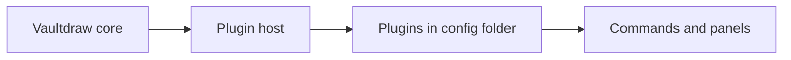

> **Caution:** Plugins are experimental in {{version}}. The interface may change, so there is no stable plugin API to build against yet.

## What exists today

Vaultdraw can load plugins that add commands and panels. A plugin is a folder:

- Plugin folders live in a `plugins/` folder inside the [config folder](/docs/configuration/) (`~/.config/vaultdraw/plugins/`).
- A plugin does nothing until you enable it by id in `config.toml`:

```toml
[plugins]
enabled = ["my-plugin"]
```

- Plugin code only loads when you first use something it adds. With no plugins enabled, the plugin host is not loaded at all.
- A plugin that crashes is switched off and reported. The rest of the app keeps working.

Plugins are trusted code: they run inside the app with full access, so only enable plugins you trust.

## Scene writes and connected diagrams

> **Next release.** Not in the current download yet. This is plugin API revision 0.4.0, and the API is still experimental.

A plugin can add and change elements on the open drawing in one batch, which is one undo step. Names in a batch (`ref`) let a plugin add boxes, bind arrows to them and group the result in a single call:

- Arrows bind to rectangles, ellipses, diamonds and text, placed on the outline.
- A plugin can store small data on elements (at most 4 KiB as JSON) and read it back.
- A batch applies only if the drawing it was made for is still the active one.
- `plugins.scene_max_ops` (default 500, 1 to 1000) caps the operations in one batch. It is read on every batch, so edits apply at once.

The example plugin `flow-diagram` in the app's `sdk/examples` inserts a connected flow from a panel button and a command. The API is described in `sdk/docs/reference.md` in the [source repository](https://github.com/Vaultdraw/vaultdraw).

## Coming next

The plan is for features that don't belong in the core app to ship as plugins, so you only pay for what you use. First in line are an AI plugin and a shape generator, with more to follow.



*The core app loads a plugin host only when a plugin is enabled. Plugins from the config folder add commands and panels.*

Follow the [changelog](/changelog/) for when plugins leave the experimental stage.
