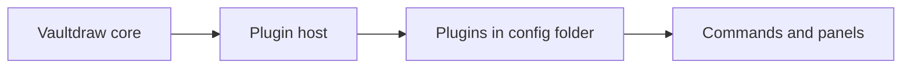

> **Caution:** Plugins are experimental in 0.1.1. The interface may change, so there is no stable plugin API to build against yet.

## What exists today

Vaultdraw can load plugins that add commands and panels. A plugin is a folder:

- Plugin folders live in a `plugins/` folder inside the [config folder](/docs/configuration/) (`~/.config/vaultdraw/plugins/`).
- A plugin does nothing until you enable it by id in `config.toml`:

```toml
[plugins]
enabled = ["my-plugin"]
```

- Plugin code only loads when you first use something it adds. With no plugins enabled, the plugin host is not loaded at all.
- A plugin that crashes is switched off and reported. The rest of the app keeps working.

Plugins are trusted code: they run inside the app with full access, so only enable plugins you trust.

## Coming next

The plan is for features that don't belong in the core app to ship as plugins, so you only pay for what you use. First in line are an AI plugin and a shape generator, with more to follow.



*The core app loads a plugin host only when a plugin is enabled. Plugins from the config folder add commands and panels.*

Follow the [changelog](/changelog/) for when plugins leave the experimental stage.
