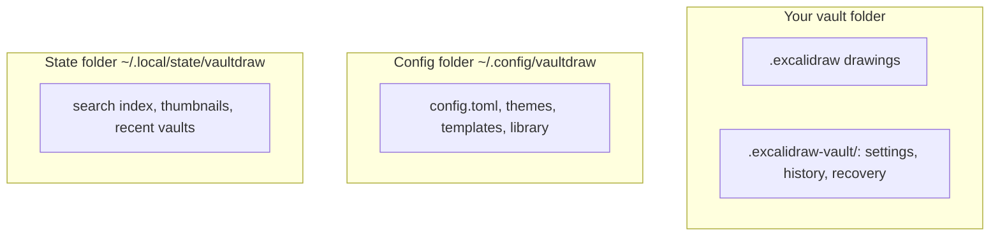

Vaultdraw has no account, no cloud and no telemetry. It doesn't connect to the internet: fonts and assets are bundled, and Mermaid diagrams, formulas and PDF pages are converted on your computer.

## Where your data lives

*Drawings and their history live in your vault. Your settings live in the config folder. Caches live in the state folder.*

| Folder | Holds | Safe to delete? |
| --- | --- | --- |
| Your vault | Your drawings, plus `.excalidraw-vault/` with the vault's settings, [file history](/docs/history/) and crash recovery | It is your data |
| `~/.config/vaultdraw/` | `config.toml`, themes, global templates, your personal library | Resets your settings |
| `~/.local/state/vaultdraw/` | Search index, thumbnails, graph layout, recent vaults, open tabs | Yes, it is rebuilt |

Nothing leaves your Mac unless you put the vault in a folder that syncs, such as iCloud Drive or Dropbox. That choice is yours.

## Open formats

Drawings are standard `.excalidraw` JSON, settings are TOML, and themes are JSON. You can read, back up or move all of it without Vaultdraw.

## Plugins

[Plugins](/docs/plugins/) run with full access inside the app. Only enable plugins you trust. With no plugins enabled, the plugin host isn't loaded.

> **Next release (0.2.0).** Each plugin is gated by a permission prompt, and a plugin that has never run always asks first. Community plugins cannot take an official plugin's id. After two crashed launches in a row the app starts with no plugins. The official plugins are bundled, on by default and switchable; the community plugin list does not exist yet.

## Data safety

> **Next release (0.2.0).** These fixes are not in the current download ({{version}}) yet.

- Quitting, closing the window and switching vault write every open note first.
- Renaming or moving a drawing onto a name that differs only by accent or Unicode form can no longer replace another file.
- Saving never replaces a read-only or Finder-locked drawing. Such files open in view mode with **Save a copy**.
- Repeated failed saves keep one recovery copy per drawing, so recovery storage does not fill up.
- `vaultdraw://cmd` links run only an allow list of safe commands.
- Downloads (themes, the plugin list) need your consent, use https to public hosts only, and are checked against a checksum. Nothing is requested in the background.

## Open source

The code is MIT licensed on [GitHub](https://github.com/Vaultdraw/vaultdraw), so you can check all of this yourself.
