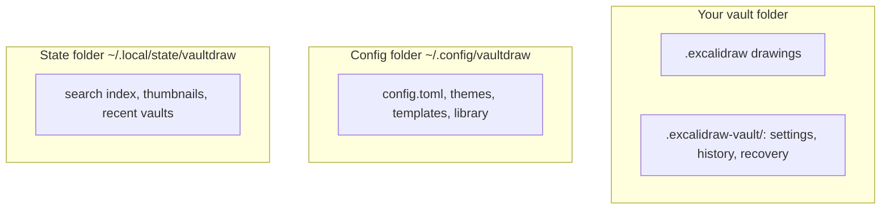

Vaultdraw has no account, no cloud and no telemetry. It doesn't connect to the internet: fonts and assets are bundled, and Mermaid diagrams, formulas and PDF pages are converted on your computer.

## Where your data lives

*Drawings and their history live in your vault. Your settings live in the config folder. Caches live in the state folder.*

| Folder | Holds | Safe to delete? |
| --- | --- | --- |
| Your vault | Your drawings, plus `.excalidraw-vault/` with the vault's settings, [file history](/docs/history/) and crash recovery | It is your data |
| `~/.config/vaultdraw/` | `config.toml`, themes, global templates, your personal library | Resets your settings |
| `~/.local/state/vaultdraw/` | Search index, thumbnails, graph layout, recent vaults, open tabs | Yes, it is rebuilt |

Nothing leaves your Mac unless you put the vault in a folder that syncs, such as iCloud Drive or Dropbox. That choice is yours.

## Open formats

Drawings are standard `.excalidraw` JSON, settings are TOML, and themes are JSON. You can read, back up or move all of it without Vaultdraw.

## Plugins

[Plugins](/docs/plugins/) run with full access inside the app. Only enable plugins you trust. With no plugins enabled, the plugin host isn't loaded.

## Open source

The code is MIT licensed on [GitHub](https://github.com/Vaultdraw/vaultdraw), so you can check all of this yourself.
