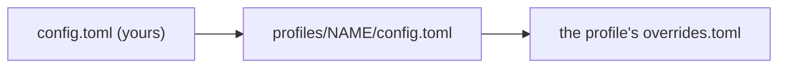

> **Next release (0.2.0).** Profiles are not in the current download ({{version}}) yet.

A profile is a named set of settings, keys, theme and extensions: one for work, one for a talk, one with every plugin off. It is a plain folder next to your `config.toml`, and it costs nothing when you use none. The default profile is your existing config, so nothing needs migrating.



*A profile layers over your `config.toml`. Later layers win.*

## What a profile can do

- It can set any key: the theme, `[hotkeys]`, plugins and tools.
- While a profile is active, Settings and `vaultdraw config set` save into that profile.
- Switching is live: no restart.
- A vault can name its own profile in `<vault>/.excalidraw-vault/profile` (just the name). Opening the vault switches to it, and your own choice comes back afterwards.
- `[control]`, `[ai]` and `[watchdog]` are read before the app starts, so a profile cannot change them. A profile's `config.toml` does not read `[include]`.

## Switch from Terminal or the palette

```bash
vaultdraw profile list                    # * marks the active one
vaultdraw profile new work                # empty; --from other, or --from default
vaultdraw profile duplicate work talk
vaultdraw profile use work                # "default" goes back to the plain config
vaultdraw profile delete talk --yes
vaultdraw --profile work config check     # check one profile without switching
```

The palette commands are `profile.switch`, `profile.new`, `profile.duplicate`, `profile.delete`, `profile.useForVault` and `profile.clearForVault`. They have no default keys and are rebindable. **Settings → General → Profile** has a switcher and New, Duplicate and Delete buttons. `VAULTDRAW_PROFILE=work` or `vaultdraw --profile work` picks a profile for one run.

Nothing is lost: creating never overwrites, and deleting a profile moves its folder to `profiles/.removed/` so you can copy it back by hand.
