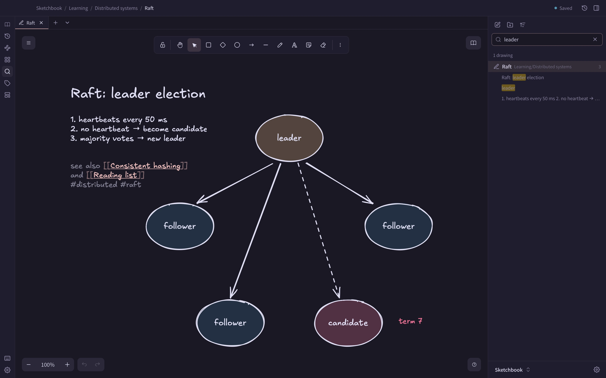
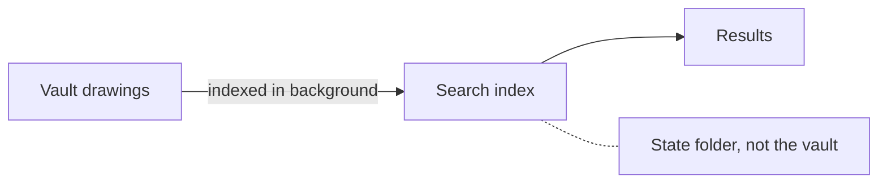

## Search the vault

Type in the search box at the top of the file tree, or press **Cmd+Shift+F** to jump there. Search looks at:

- drawing names and folder paths
- text elements
- labels inside shapes and arrows
- frame names
- the source of LaTeX formulas, so `\int` is findable like text

Text inside library items is not searched.

Results are grouped by drawing, with up to five highlighted snippets each. Use **Up** and **Down** to move, **Enter** to open a row and **Esc** to clear the search. Click a snippet and the drawing opens zoomed to that element, with it selected. For a label, the shape or arrow it belongs to is selected.

## Matching rules

- Case, accents and character width are ignored: `cafe` finds `Café`, and full-width letters find plain ones.
- A term can match inside a word: `graph` finds `Dijkstra graphs`.
- Every word you type must appear in the drawing, but the words can be in different elements.
- Chinese, Japanese and Korean text is searched as written, without spaces between words.

## Filter by tag

Add `tag:#name` to a search to limit results to drawings with that tag. It combines with words: `tag:#dsa graph`. See [Tags](/docs/tags/).

## The search index

*Drawings are indexed in the background into a search index that lives in the state folder, outside your vault.*

The index is in `~/.local/state/vaultdraw/index/` by default, and `VAULTDRAW_STATE_DIR` changes the folder. Nothing is written into your vault. It is rebuilt automatically when it is missing or damaged, so it is safe to delete.

The first time a large vault is indexed, the status line shows progress such as "Indexing 1,234 of 5,000 drawings…". Results cover only the drawings indexed so far.

From a terminal, `vaultdraw search` searches the same way. See [Command line](/docs/cli/).
