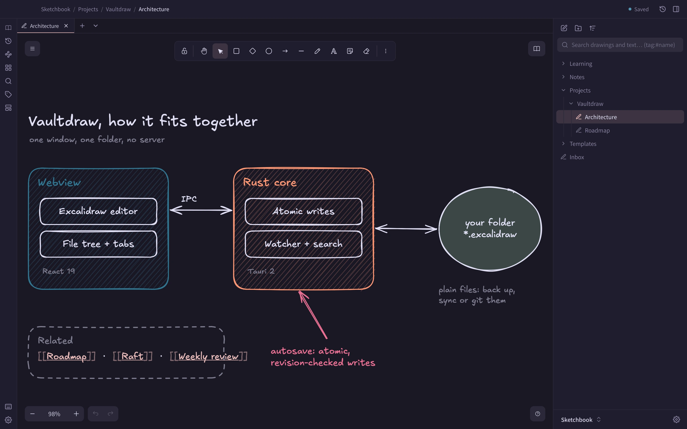
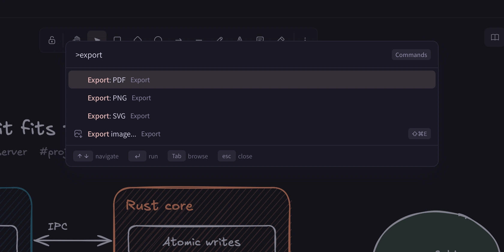

## The window

| Part | What it does |
| --- | --- |
| **Navigator** | The vault's file tree. Create, rename, move and trash drawings and folders. Show or hide it with **Cmd+\\**. |
| **Tabs** | Several open drawings at once. See [Tabs](/docs/tabs/). |
| **Activity bar** | A thin bar of buttons for the main panels: Library, History, Graph view, Gallery, Search, Tags and Templates, plus Hotkeys and Settings. You can reorder it and hide buttons. |
| **Header** | Visible entry points for History, Graph and Library, plus **New from template**. |
| **Canvas** | The Excalidraw editor. Its menu and right-click menu hold the rest, such as page setup and **Import file**. |

Every button also exists as a command in the palette, so you never have to find it with the mouse. Hover a button to see its key.

## Command palette

Two keys cover most of the app:

- **Cmd+P** opens any drawing by name.
- **Cmd+Shift+P** runs any command: themes, modes, settings pages, export, templates, insert actions and more.

Matching is fuzzy, and recently used items come first. See [Keyboard](/docs/keyboard/).

## Settings

Press **Cmd+,** to open Settings, a page with sections and search. Everything in it is also in a plain-text file you can edit by hand. See [Settings](/docs/settings/).

## Home screen and gallery

With no drawing open, the home screen shows your recent drawings with thumbnails. **Gallery** (**Cmd+Option+E**) shows a whole folder as a grid of thumbnails. Thumbnails are stored outside your vault, and you can turn them off.

## Find, link and look back

- **Search** (**Cmd+Shift+F**) looks inside every drawing. See [Search](/docs/search/).
- **Links** (`[[Name]]`), backlinks and the **Graph view** connect drawings. See [Links](/docs/links/) and [Graph](/docs/graph/).
- **History** (**Cmd+Shift+H**) brings back earlier versions. See [File history](/docs/history/).
